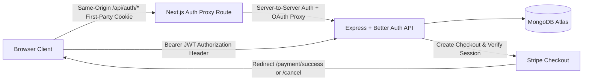

<div align="center">


# GearNest — Equipment Rental Marketplace

**Find the right equipment. Rent with confidence.**

A full-stack, multi-role equipment rental marketplace built with **Next.js 16 App Router**, **React 19**, and **Tailwind CSS 4**—connecting customers, equipment owners, and platform administrators through real-time catalog discovery, verified availability holds, and Stripe Hosted Checkout.

<p>
  <a href="https://b14-a-009-client.vercel.app">
    
  </a>
  <a href="https://github.com/iRfANhAiDeRABiR/b14-A-009-server">
    
  </a>
</p>

<p>
  
  
  
  
  
</p>

[Live Application](https://b14-a-009-client.vercel.app) · [API Health](https://b14-a-009-server.onrender.com/api/health) · [Server Repository](https://github.com/iRfANhAiDeRABiR/b14-A-009-server) · [Report Issue](https://github.com/iRfANhAiDeRABiR/b14-A-009-client/issues)

</div>

---

## Table of Contents

- [Project Overview](#-project-overview)
- [Role Portals](#-role-portals)
- [Key Features](#-key-features)
- [Architecture & Auth Proxy](#-architecture--auth-proxy)
- [Technology Stack & Packages](#-technology-stack--packages)
- [Application Routes](#-application-routes)
- [Getting Started](#-getting-started)
- [Environment Configuration](#-environment-configuration)
- [Project Structure](#-project-structure)
- [Available Scripts](#-available-scripts)
- [Deployment & Verification](#-deployment--verification)

---

## Project Overview

**GearNest** provides a unified marketplace interface for renting commercial and specialized equipment across six curated categories:

- **Construction Equipment**
- **Photography Equipment**
- **Vehicles & Transportation**
- **Agriculture Equipment**
- **Electronics**
- **Event Equipment**

Every catalog page, rental calculator, checkout hold, and role dashboard connects directly to the Express & MongoDB REST API (`https://b14-a-009-server.onrender.com`) with strict session verification, short-lived memory-only JWT bearer tokens, and fail-closed `401`/`403` handling.

---

## Role Portals

| Role | Workspace Scope | Core Capabilities |
| :--- | :--- | :--- |
| **Customer** | `/dashboard/customer` | Browse approved inventory, save favorites, estimate rental totals, reserve date windows, pay via Stripe Hosted Checkout, and track rental history & receipts. |
| **Owner** | `/dashboard/owner` | Upload equipment photos via backend ImgBB proxy, publish new listings, update specs & pricing, track fleet approvals, and inspect earnings analytics & bookings. |
| **Admin** | `/dashboard/admin` | Review & moderate equipment (`Approve` / `Reject` / `Edit` / `Delete`), govern user roles & account status (`Active` / `Suspended`), add internal rental notes, triage support inquiries, audit event logs, export CSV reports, and monitor platform revenue. |

---

## Key Features

### Public Marketplace & Discovery
- **Homepage Showcase:** Hero search launcher, interactive category strip, live featured/recent equipment carousels, how-it-works workflow, trust indicators, and a continuous 4-column vertical-sliding sample review marquee.
- **Live Search & Filtering (`/equipment`):** Server-backed search, category filtering, rental term filters (`Daily`, `Weekly`, `Monthly`), price bounds, availability status, sorting, and pagination synced with URL query parameters.
- **Equipment Details & Booking Modal (`/equipment/[id]`):** Dynamic technical specification grid, owner identity card, date-aware availability checker, live rate estimator, and guided booking modal with copyable Stripe Test Mode card helper.

### Security, Payments & UX
- **First-Party Same-Origin Auth Proxy (`/api/auth/[...all]`):** Proxies Better Auth requests through Next.js to deliver host-only, `HttpOnly`, `SameSite=Lax` first-party cookies so sessions persist seamlessly across normal tabs, Chrome Incognito, Safari ITP, and page refreshes without storing secrets in `localStorage`.
- **In-Memory JWT Exchange:** Protected API service modules attach short-lived Bearer JWTs retrieved from `/api/auth/token` strictly in memory, refreshing automatically before expiry or retrying once on `401`.
- **Stripe Checkout & Return Verification:** `/payment/success` checks backend webhook finalization and triggers `POST /api/payments/session/:sessionId/verify` reconciliation against Stripe's live session & PaymentIntent status before displaying confirmation. `/payment/cancel` surfaces cancellation details and clean checkout retry navigation.
- **Adaptive Light & Dark Theme:** Semantic design-token theme palette (`#193D34` forest green, `#D9A441` amber accent, `#F7F8F4` surface background) with dark mode persistence and `prefers-reduced-motion` accessibility support.

---

## Architecture & Auth Proxy



1. **Auth Mutations & Sessions:** Browser calls `/api/auth/*` on the same origin (`b14-a-009-client.vercel.app`), keeping session cookies strictly first-party (`SameSite=Lax`, `HttpOnly`, `Secure`).
2. **REST API Requests:** `apiClient.js` mints an in-memory JWT from `/api/auth/token` and attaches `Authorization: Bearer <jwt>` to every request sent to `NEXT_PUBLIC_API_BASE_URL`.
3. **Google OAuth:** Supported cleanly across domains via Better Auth's `oAuthProxy` replay back through `/api/auth/callback/google/oauth-proxy`.

---

## Technology Stack & Packages

| Package | Version | Purpose |
| :--- | :--- | :--- |
| `next` | `16.4.6` | App Router framework, Turbopack bundling, dynamic API proxy routes, and hybrid static/streaming rendering |
| `react` / `react-dom` | `19.3.0` | UI rendering and component state hooks |
| `better-auth` | `1.7.27` | React session client (`createAuthClient`, `useSession`, `jwtClient`) |
| `tailwindcss` / `@tailwindcss/turbopack` | `4.3.3` | Utility styling and CSS variable theming |
| `framer-motion` | `14.14.0` | Viewport reveals, interactive drawers, and reduced-motion aware transitions |
| `lucide-react` | `1.77.0` | Crisp icon set across dashboards, forms, and catalog badges |
| `clsx` / `tailwind-merge` | `2.1.1` / `3.7.1` | Conditional class composition via `cn()` |
| `eslint` / `eslint-config-next` | `^9` / `16.4.6` | Code quality and Next.js linting rules |

---

## Application Routes

<details>
<summary>View complete route inventory (35 routes + dynamic auth proxy)</summary>

### Public Routes
| Route | Description |
| :--- | :--- |
| `/` | Landing page, category directory, featured/recent gear, and sliding customer feedback marquee |
| `/equipment` | Searchable, filterable, sortable, paginated equipment marketplace |
| `/equipment/[id]` | Equipment detail sheet, owner overview, terms, favorites, and reservation modal |
| `/how-it-works` | Step-by-step guide for Renters and Equipment Owners |
| `/about` | Marketplace mission, standards, and operating model |
| `/contact` | Validated contact & support inquiry form backed by `POST /api/contact` |
| `/help-center` | Rental policies, verification, and payment FAQ |
| `/terms` / `/privacy` | Platform terms of service and privacy policy |
| `/login` / `/register` | Email/password & Google OAuth sign-in and Customer registration |

### Auth Proxy & Stripe Return Routes
| Route | Description |
| :--- | :--- |
| `/api/auth/[...all]` | Same-origin server proxy forwarding Better Auth cookies and OAuth callbacks |
| `/payment/success` | Polls & triggers Stripe session verification before showing booking confirmation |
| `/payment/cancel` | Displays cancellation context with eligible reservation checkout retry |

### Protected Dashboard Routes
| Route | Role | Purpose |
| :--- | :--- | :--- |
| `/dashboard` | Any Auth | Role-aware dashboard router |
| `/dashboard/customer` | Customer | Rental stats and quick marketplace links |
| `/dashboard/customer/my-rentals` | Customer | Active bookings, payment statuses, and rental history |
| `/dashboard/customer/favorites` | Customer | Saved equipment watchlist |
| `/dashboard/customer/profile` | Customer | Profile details & photo management |
| `/dashboard/owner` | Owner | Fleet analytics charts, utilization metrics, and recent bookings |
| `/dashboard/owner/add-equipment` | Owner | Validated listing submission with ImgBB photo upload |
| `/dashboard/owner/my-equipment` | Owner | Inventory management table (`Pending`, `Approved`, `Rejected`) |
| `/dashboard/owner/my-equipment/edit/[id]` | Owner | Pre-filled listing editor |
| `/dashboard/owner/rentals` | Owner | Customer reservations placed against owner listings |
| `/dashboard/owner/profile` | Owner | Owner profile management |
| `/dashboard/admin` | Admin | Platform KPIs, deduplicated revenue charts, and analytics filters |
| `/dashboard/admin/users` | Admin | User directory, role changes, suspend/reactivate, edit profile, & delete |
| `/dashboard/admin/equipment` | Admin | Equipment moderation queue (`Approve`, `Reject`, `Edit`, `Delete`) + audit history |
| `/dashboard/admin/rentals` | Admin | Platform bookings table, CSV export, and internal governance notes |
| `/dashboard/admin/inquiries` | Admin | Customer contact inbox with resolve & cleanup controls |
| `/dashboard/admin/logs` | Admin | Filterable administrative audit log timeline & CSV export |
| `/dashboard/admin/profile` | Admin | Administrator profile settings |

</details>

---

## Getting Started

### Prerequisites
- **Node.js** `>= 18.18.0`
- Running instance of the [GearNest API Server](https://github.com/iRfANhAiDeRABiR/b14-A-009-server)

### Installation

```bash
# 1. Clone the repository
git clone https://github.com/iRfANhAiDeRABiR/b14-A-009-client.git
cd b14-A-009-client

# 2. Install dependencies
npm install

# 3. Copy environment template and set your backend URL
cp .env.example .env.local

# 4. Run development server
npm run dev
```

Open [http://localhost:3000](http://localhost:3000) in your browser.

---

## Environment Configuration

Create a `.env.local` file from [`.env.example`](.env.example):

| Variable | Required | Description | Example |
| :--- | :--- | :--- | :--- |
| `NEXT_PUBLIC_API_BASE_URL` | **Yes** | Express backend origin (used for API calls and `/api/auth/[...all]` proxy) | `http://localhost:5000` |
| `NEXT_PUBLIC_SITE_URL` | **Yes** | Canonical public URL of the frontend | `http://localhost:3000` |
| `NEXT_PUBLIC_IMGBB_API_KEY` | No | Optional client ImgBB key for avatar uploads on `/register` | *(leave blank if unused)* |
| `NEXT_PUBLIC_STRIPE_PUBLISHABLE_KEY` | No | Optional Stripe publishable key (`pk_test_...`) | `pk_test_...` |

> **Security Note:** Never place private secrets (`MONGODB_URI`, `BETTER_AUTH_SECRET`, `STRIPE_SECRET_KEY`, `GOOGLE_CLIENT_SECRET`, or `IMGBB_API_KEY`) in client environment variables.

---

## Project Structure

```text
src/
├── app/
│   ├── api/auth/[...all]/    # First-party same-origin Better Auth proxy
│   ├── dashboard/            # Customer, Owner, and Admin workspace pages
│   ├── equipment/            # Catalog listing & [id] detail pages
│   ├── payment/              # Stripe Checkout success & cancel return pages
│   ├── globals.css           # Tailwind CSS 4 theme tokens & marquee animations
│   └── layout.js             # Root layout, providers, and typography
├── components/
│   ├── admin/                # Moderation, user governance, logs, inquiries, rentals
│   ├── auth/                 # Login/Register forms, ProtectedRoute, OAuth UI
│   ├── dashboard/            # Sidebar, header, charts, KPI cards
│   ├── equipment/            # Cards, grids, search bars, booking summary & modals
│   ├── home/                 # Hero, category grid, featured/recent gear, CustomerReviews
│   ├── owner/                # Owner listing forms, image uploader, fleet analytics
│   ├── payment/              # Status views & StripeTestCardBox helper
│   └── ui/                   # Reusable design system primitives
├── context/                  # AuthProvider, FavoriteProvider, ThemeProvider, ToastContext
├── data/                     # Static category definitions, fallback previews, & sample reviews
├── hooks/                    # Custom data-fetching and session hooks
├── lib/                      # apiClient, auth-client, authValidation, token-provider, formatters
└── services/                 # Typed domain API modules per backend resource
```

---

## Available Scripts

| Command | Description |
| :--- | :--- |
| `npm run dev` | Starts Next.js development server on port `3000` |
| `npm run build` | Creates optimized production build (`next build`) |
| `npm run start` | Serves the production build |
| `npm run lint` | Runs ESLint across the client codebase |

---

## Deployment & Verification

- **Production Frontend:** [https://b14-a-009-client.vercel.app](https://b14-a-009-client.vercel.app)
- **Production API:** [https://b14-a-009-server.onrender.com](https://b14-a-009-server.onrender.com)
- **Server Repository:** [https://github.com/iRfANhAiDeRABiR/b14-A-009-server](https://github.com/iRfANhAiDeRABiR/b14-A-009-server)

<details>
<summary>Submission Readiness Checklist</summary>

- [x] Client & Server repositories published separately on GitHub and cross-linked
- [x] `npm run lint` passes with zero ESLint errors and `npm run build` builds all 35+ routes cleanly
- [x] Environment configuration isolated in `.env.local` / Vercel Environment Variables without secret leakage
- [x] Email/Password, Google OAuth, and role-protected dashboards verified across refresh and Incognito mode
- [x] All 6 equipment categories populated with approved listings, working product photography, and search/filtering
- [x] Stripe Test Mode Checkout & post-payment verification integrated cleanly

</details>
